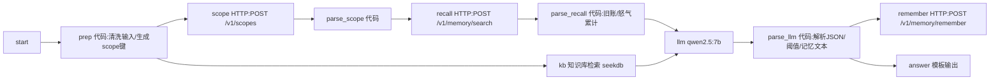

# 设计说明

## 1. 作品定位

「记仇酒馆」把大模型从"会聊天的 NPC"变成"有账本的 NPC"。
玩家每一轮的恶作剧都会落成一条可检索的长期记忆；下一次（哪怕新开对话）进门，老周先翻账，再决定用什么态度、什么手段回应。

三个技术点各自承担不可替代的职责：

| 技术 | 如果不是它 | 本作品里的实际作用 |
| --- | --- | --- |
| PowerContext | 换成聊天历史，跨会话就失忆；换成提示词，账本无法增长 | scope 隔离玩家、`remember` 写入、`search` 跨会话召回、累计怒气驱动升级 |
| seekdb | 换成硬编码提示词，图鉴不可扩展、检索不可验证 | 中文语义检索命中招式说明，把"反制手段/危险度"带进本轮上下文 |
| Dify Chatflow | 换成脚本，无法演示可视化编排与模型接入 | 11 节点串起"建账 → 翻账 → 查图鉴 → 判罚 → 记账 → 作答" |

## 2. 流程与节点



| # | 节点 | 类型 | 关键行为 |
| --- | --- | --- | --- |
| 1 | `start` | start | 输入变量 `player_name` |
| 2 | `prep` | code | 清洗玩家名与台词（去引号/换行/反斜杠）；生成 `scope_title=记仇酒馆::<玩家>`、`idempotency_key=grudge-scope::<玩家>`、召回查询 `player + " 怒气"` |
| 3 | `scope` | http-request | `POST {POWERCONTEXT}/v1/scopes`，同 key 幂等，返回既有或新建 scope |
| 4 | `parse_scope` | code | 解析 `scope_id`，失败时 `scope_ok=no` |
| 5 | `recall` | http-request | `POST {POWERCONTEXT}/v1/memory/search`，`limit=50`、`mode=auto` |
| 6 | `parse_recall` | code | 提取 `hits[].text` 去重；正则 `怒气\s*[+＋]\s*(\d+)` 累加历史怒气；生成最多 6 条旧账摘录 |
| 7 | `kb` | knowledge-retrieval | 用玩家台词在 seekdb 中检索图鉴，`top_k=3`，无重排 |
| 8 | `llm` | LLM | `qwen2.5:7b`，temperature 0.6，max_tokens 700；system prompt 注入人设、升级规则、历史怒气与图鉴；要求严格输出 JSON |
| 9 | `parse_llm` | code | 解析 `{reply, verdict, grudge_delta, memory}`；`delta` 钳制 0–5；按"历史怒气 + 本轮增量"计算总值与状态；补全记忆文本并确保含 `（怒气 +N）`；去重图鉴标题 |
| 10 | `remember` | http-request | `POST {POWERCONTEXT}/v1/memory/remember`，`kind=grudge_event` |
| 11 | `answer` | answer | 输出台词、怒气值、判定、状态、召回条数、图鉴、旧账摘录 |

## 3. 数据契约

### 3.1 PowerContext

- Scope 键：`grudge-scope::<player_name>`（幂等）
- 记忆条目：`kind=grudge_event`，`text` 必含 `怒气 +N`
- 召回：`mode=auto`（无 embedding 时自动走 FTS）

### 3.2 LLM 输出

```json
{
  "reply": "老周的台词（≤80 字）",
  "verdict": "记仇|暴怒|和解|无感",
  "grudge_delta": 3,
  "memory": "第三人称总结：玩家做了什么、老周怎么反应、怒气+几"
}
```

解析失败时：回复取原始文本去掉 JSON 片段；`delta` 默认 2；记忆文本按模板重建。保证坏输出不会中断流程。

## 4. 怒气与升级设计

| 累计怒气 | 老周状态 | 行为 |
| --- | --- | --- |
| 0–3 | 装没事 | 嘴硬、装作不在意 |
| 4–7 | 冷脸 | 简短、带刺，开始提旧账 |
| 8–14 | 擀面杖 | 主动报复：往酒里加料、拿出擀面杖 |
| ≥15 | 通缉令 | 拒客、下通缉令 |

单轮增量由模型判定并钳制在 0–5，避免一轮把账本打爆；累计值完全由 PowerContext 中召回的历史条目计算，篡改本轮输出无法抹掉旧账。

## 5. 失败与边界处理

- PowerContext 不可用：`parse_scope`/`parse_recall` 给出 `no`，流程继续，按"新玩家"作答（不会 500）。
- 知识库为空 / 未回填 Dataset ID：`kb` 返回空数组，`kb_titles` 显示"未命中图鉴"，回答仍可用。
- 模型输出非 JSON：解析兜底（见 §3.2）。
- 中英文与标点：`prep` 统一清洗，避免 JSON 注入破坏 HTTP 节点 body。
- 中文乱码：Windows 原生部署时通过插件子进程 UTF-8 环境修复（见 `docs/03-dependencies.md` §6）。

## 6. 已知限制

1. **FTS 查询长度**：PowerContext 未配置 embedding 时走 SQLite FTS5，长句查询容易召回为空；因此召回查询固定为「玩家名 + 怒气」这一短关键词组合，召回范围由 scope 限定，不依赖查询语义。
2. **无重排**：图鉴检索未启用 rerank，`top_k=3` 中可能包含弱相关段落，靠 LLM 自行取舍。
3. **玩家身份即名字**：同名即同账本，没有账号体系；演示时用不同名字即可隔离。
4. **PowerContext 默认无鉴权**：仅监听本机；对外部署需加反向代理与访问控制。
5. **7B 模型的 JSON 稳定性**：已做多级兜底，但极端输入下 `verdict` 可能不在枚举内（会被原样透出，不影响流程）。
